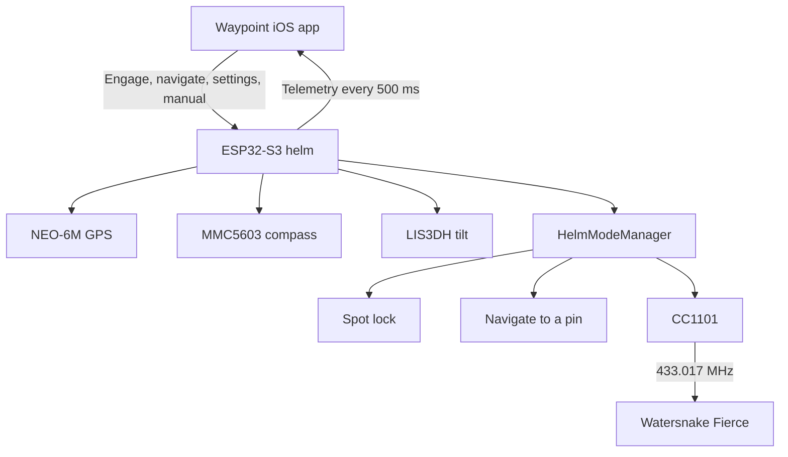

# AutoHelm

AutoHelm holds a Watersnake Fierce bow-mount trolling motor on a GPS pin, and drives the boat to a chosen pin at one motor level. An ESP32-S3 helm reads GPS and compass, decides steering and speed, and transmits 433 MHz commands that imitate the Watersnake handset. The Waypoint iOS app configures the helm, shows its state, and sends high-level commands.

The control loop runs on the helm. Once spot lock or navigation is running, the boat keeps that mode if the phone disconnects.

This is a working prototype on the current parts: NEO-6M GPS, MMC5603 compass, LIS3DH accelerometer, CC1101 radio, and ESP32-S3. It has not completed a water acceptance test. [docs/design-spec.md](docs/design-spec.md) is the contract for the control behavior still to be brought in line with that test.

## Architecture



| Piece | Responsibility |
|---|---|
| `HelmModeManager` | One autonomous user of the radio. Sequences spot lock, navigation, ramp-down, arrival handoff, and GPS fault |
| `SpotLockController` | Holds a coordinate. Thrust scales with distance outside a dead zone |
| `WaypointNavController` | Steers to a waypoint, then hands off to spot lock on arrival |
| `Remote` + `CC1101` | Manchester bursts for the handset button codes. Learns the handset id |
| `GpsManager` | NMEA on UART2: fix, satellites, HDOP, position |
| `CompassManager` | MMC5603 heading, hard-iron and soft-iron calibration in NVS |
| `LIS3DHManager` | Pitch and roll, applied to heading when the accelerometer starts |
| Waypoint | Map, waypoints, tracks, settings, and a Bluetooth central |

## What the software does today

- Spot lock and navigate-to-a-pin both run on the helm. The app uploads settings and a target, then renders telemetry.
- Manual Left, Right, Up, Down, Motor, and Momentary commands are sent only while the helm is Idle or Fault.
- A BLE disconnect starts a grace timer, default 5 seconds, clamped to 1–30 seconds. Reconnecting inside that window leaves the motor alone. If the timer expires during spot lock or navigation, that mode continues. If it expires while idle, the helm releases a manual hold and runs a safety stop.
- Optional BLE authentication. An empty `BLE_AUTH_SECRET` leaves auth off for bench work. A non-empty secret must match the secret in Waypoint settings. Privileged commands are refused until `AUTH:` succeeds.
- The Watersnake handset id can be captured from the app and stored on the helm. See [Handset id](#handset-id).
- Compass calibration is stored on the helm and uploaded again from the app on connect.
- Waypoint keeps waypoints and recorded tracks on the phone.

Spot lock uses an 8 m dead zone and a 12 m activation radius. Navigation holds the chosen motor level until the boat is inside a 15 m arrival radius, then spot-locks that pin. Steering presses are at least 500 ms. The control contract is [docs/design-spec.md](docs/design-spec.md).

## Where this is going

The radio, GPS, compass, tilt, and BLE transport stay. The control loop follows the contract in [docs/design-spec.md](docs/design-spec.md).

Behavior on the current NEO-6M:

- Spot lock thrusts only outside about 12 m and stops thrusting inside about 8 m.
- Navigation holds the motor level chosen for that trip until the boat is inside a 15 m arrival radius, then spot-locks that pin. There is no slow-down zone.
- A motor press is a stream of bursts for at least 500 ms, normally 1 second, then one Release. A single burst is not a press.
- Engaging from an unknown speed zeros the motor with ten 1-second Down presses before any Up.
- A persistent heading error keeps producing steering in that direction.
- GPS failures count once per correction cycle. One stale sample does not end the mode.
- The app locks manual controls while `helm_state` is 1, 2, or 4, including zeroing and ramp-down.

Out of scope for that work: multi-waypoint routes, closed-loop speed in knots, a new radio protocol, and a rewrite of the iOS app. A later hardware step, only after this software holds on the water, is a small production board and ACMA compliance for 433 MHz. The first GPS improvement, if the NEO-6M antenna placement is not enough, is a clear-sky L1 antenna on the existing receiver.

The December 2025 wishlist in `AutoHelm roadmap 202512.md` is not the current plan.

## Hardware

All radio and sensor modules are 3.3 V. Do not feed them 5 V.

| Function | GPIO | Notes |
|---|---|---|
| CC1101 CS | 5 | SPI chip select |
| CC1101 GDO0 | 4 | Transmit data, and receive data during handset capture |
| CC1101 SCK / MISO / MOSI | 18 / 19 / 23 | SPI |
| GPS RX / TX | 16 / 17 | UART2, 9600 8N1. GPS TX goes to GPIO 16 |
| I2C SDA / SCL | 21 / 22 | MMC5603 at `0x30`, LIS3DH at `0x19` |

The helm does not switch the motor's power. The operator turns the motor on. Autonomy transmits Left, Right, Up, Down, and Release.

Serial console: 115200 baud. `R/L/U/D/M/S` hold a button, `r/l/u/d/m/s` send one burst, `0` sends Release, `g`/`G` GPS, `c`/`C` compass, `v` sensor status. Motor keys are ignored while a handset capture is listening.

## Firmware

1. Install the ESP32 board package and the **Adafruit MMC56x3** library in the Arduino IDE.
2. Copy `Helm/secrets.h.example` to `Helm/secrets.h`. `secrets.h` is gitignored.
3. Leave `DEVICE_ID` as `000000000000` and capture the handset from Waypoint, or paste a known 12-digit id.
4. Leave `BLE_AUTH_SECRET` empty for bench work, or set the same 8–64 character secret the app will send.
5. Open `Helm/Helm.ino`. Board: ESP32-S3. Upload.

`000000000000` is not a valid id. Until a real id is stored, the helm will not transmit.

### Handset id

Each Fierce handset has its own 48-bit id. The button codes are fixed. Waypoint learns the id:

1. Connect to the helm. Spot lock and navigation must be idle.
2. **Settings → Motor Remote → Capture from handset.**
3. Hold the handset next to the helm. Press one button until the app names it, then press a different button on the same handset.
4. The helm stores the id in NVS under the namespace `remote`, key `devid`. That id overrides `secrets.h` on later boots.

The handset still commands the motor while the helm is only listening, so those two presses can move the prop. Keep the prop clear. Release presses are ignored. The listen window is 45 seconds. **Forget saved handset** clears the stored id.

If the helm never reports a button, an RTL-SDR remains a fallback:

```bash
rtl_433 -f 433.017M -s 250k -g 40 -R 0 \
  -X 'n=Watersnake,m=FSK_MC_ZEROBIT,s=52,l=104,r=200'
```

The 12 hex digits after the sync word `d391d391` are the id. The following 7 hex digits are the button.

## Waypoint

Requirements: Xcode, iOS 18.6 or later.

```bash
cd Waypoint
open Waypoint.xcodeproj
```

Set the development team in Signing & Capabilities, then run. The app looks for a Bluetooth peripheral named `Helm`.

Tabs: Map, Helm, Waypoints, Tracks, Settings.

On connect, Waypoint uploads spot-lock settings, navigation settings, compass calibration, and asks for the saved handset id. If a BLE secret is configured, it authenticates first.

## Bluetooth

| | |
|---|---|
| Device name | `Helm` |
| Service | `0000FFE0-0000-1000-8000-00805F9B34FB` |
| FFE2 Notify | Sensor, spot-lock, and navigation telemetry, about every 500 ms |
| FFE3 Write | Commands |
| FFE4 Notify | Compass calibration samples |
| FFE5 Notify | JSON acknowledgements |

### Commands

Privileged commands require `AUTH:` when `BLE_AUTH_SECRET` is set.

```
AUTH:<secret>

SPOTLOCK_ENGAGE:<lat>,<lon>
SPOTLOCK_DISENGAGE
SPOTLOCK_JOG:FORWARD|BACK|LEFT|RIGHT
SPOTLOCK_SETTINGS:<21 fields>

NAV_START:<lat>,<lon>,<level>
NAV_CANCEL
NAV_SETTINGS:<20 fields>

PAIR_START
PAIR_CANCEL
PAIR_STATUS
PAIR_CLEAR

START_CAL
STOP_CAL
CAL_VALUES:<ox,oy,oz,sx,sy,sz,headingOffset>

RF_LEFT_HOLD / RF_RIGHT_HOLD
RF_UP / RF_DOWN / RF_MOTOR / RF_MOMENTARY
RF_RELEASE
```

`SPOTLOCK_SETTINGS` fields, in order: dead zone m, activation m, jog m, min speed, max speed, gain, speed-change delay s, heading tolerance deg, correction interval s, small angle, large angle, small steering ms, medium steering ms, large steering ms, max rotation deg, rotation per ms, min satellites, max HDOP, max GPS failures, filter window, disconnect grace s. The filter window is accepted and ignored. A 20-field packet still parses, and the grace period stays at its current value.

`NAV_SETTINGS` uses the same order. Field 1 is the arrival radius. The navigation controller uses the level from `NAV_START` as the cruise level.

`helm_state` in telemetry:

| Value | Meaning |
|---|---|
| 0 | Idle |
| 1 | Spot lock active |
| 2 | Navigating toward the pin |
| 3 | Reserved. The helm does not use an arriving state |
| 4 | Zeroing, ramping down, or handing off to spot lock |
| 5 | Fault, usually GPS lost |

Telemetry also carries `has_fix`, `satellites`, `currentLat`, `currentLon`, `altitude`, `hdop`, `heading`, `sl_active` and `sl_*` while spot lock is active, `nav_active` and `nav_*` while navigation is active, `ble_authed`, and `disconnect_grace_s`.

## Radio

| Parameter | Value |
|---|---|
| Frequency | 433.017 MHz |
| Modulation | 2-FSK |
| Encoding | Manchester. Bit 0 is low then high. Bit 1 is high then low. 52 µs per half |
| Retransmit | Every 68 ms while a button is held |
| Reliable press | At least 500 ms of bursts, then Release |

Packet, 35 hex digits, 140 bits, MSB first inside each nibble:

```
preamble   sync       handset id    button
2aaaaaaa   d391d391   12 hex        7 hex
```

| Button | Code |
|---|---|
| Right | `08696a8` |
| Left | `0269568` |
| Up | `0469428` |
| Down | `806a5a8` |
| Motor | `4068da8` |
| Momentary | `10693a8` |
| Release | `00e9590` |

## Repository

```
AutoHelm/
├── Helm/                         ESP32 firmware
│   ├── Helm.ino                  Main loop
│   ├── HelmModeManager.*         Spot lock, navigation, and fault sequencing
│   ├── SpotLockController.*      Position hold
│   ├── WaypointNavController.*   Transit to a pin
│   ├── AutopilotMotorController.*  Shared steering and speed presses
│   ├── Remote.*                  Manchester encode, transmit, handset capture
│   ├── CC1101.*                  Radio driver
│   ├── GpsManager.*
│   ├── CompassManager.*
│   ├── LIS3DHManager.*
│   ├── BleManager.*              Peripheral, commands, telemetry
│   ├── BleAuth.*
│   └── secrets.h.example
├── Waypoint/                     iOS app
├── docs/design-spec.md           Control behavior the helm implements
└── compass_calibration/          Standalone compass helper
```

## First bench session

1. Flash the helm and confirm the serial log shows the CC1101, GPS, compass, and BLE starting.
2. Capture the handset, or confirm a real `DEVICE_ID` is loaded. A one-second Up from the serial console should move the motor one level.
3. Calibrate the compass in Waypoint: rotate the helm through all axes, then stop. The result is stored on the device.
4. With a GPS fix, engage spot lock only after the prop is clear and the motor is on.

Treat the first on-water run as a test of the 8 m dead zone and 12 m activation radius, with the prop clear and the motor on.

## Troubleshooting

**No GPS fix.** Give the NEO-6M 30–60 seconds of open sky. GPS TX must land on GPIO 16. The serial log prints when the first fix arrives.

**The motor never moves.** The helm has no handset id, the CC1101 wiring is wrong, or the motor is off. Capture the id from **Settings → Motor Remote**, or set `DEVICE_ID`. A capture that never hears a button needs the handset closer to the helm, or the RTL-SDR fallback.

**Spot lock or navigation will not start.** The helm requires a fix, at least 4 satellites, and HDOP under 5. The serial log and the FFE5 error name the rejected command.

**Waypoint cannot connect.** Confirm the phone's Bluetooth permission and that `Helm` is advertising. If a BLE secret is set, it has to match `BLE_AUTH_SECRET`.

**Settings look unchanged.** Settings upload on connect. Reconnect, and watch for `SPOTLOCK_SETTINGS` or `NAV_SETTINGS` in the helm log.

## Issues

https://github.com/brentonford/AutoHelm/issues
