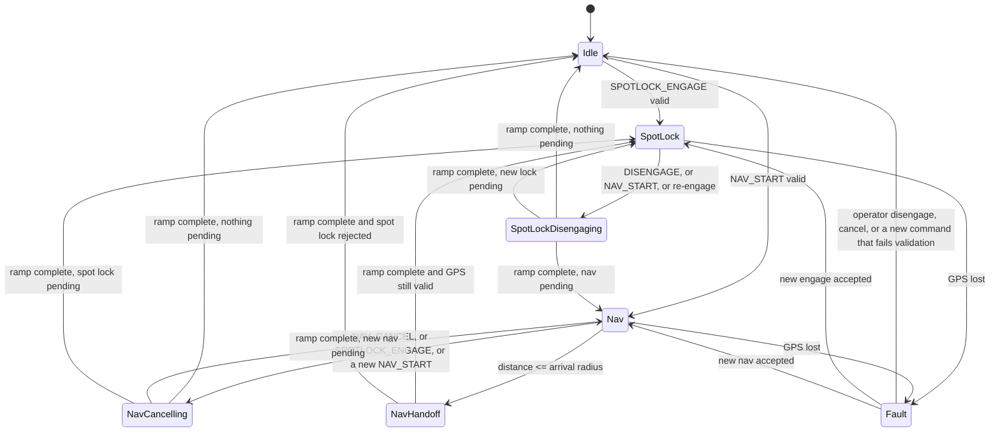

# AutoHelm control design specification

Status: control contract implemented on `feature/spotlock-and-navigate`.
Date: 30 October 2026.

This document is the contract for spot lock and fixed-level navigation. It specifies what the helm does on the water.

The radio protocol, GPS parser, compass driver, tilt compensation, and BLE transport stay. The control loop is replaced against this spec. The iOS app remains a remote: it sends commands and renders device telemetry.

## 1. Purpose

AutoHelm holds an electric trolling motor on a GPS pin, and drives the boat to a chosen pin at one selected motor level, then holds that pin.

The ESP32-S3 helm is the controller. It reads GPS and compass, decides steering and speed, and transmits 433 MHz commands to the motor. The Waypoint iOS app configures the device, shows its state, and sends high-level commands. The phone is not in the control loop. If the phone disconnects after a mode is running, the helm keeps running that mode.

Two operator outcomes:

1. **Spot lock.** The boat stays near a lock coordinate. It thrusts only when it has drifted outside an outer radius, and it stops thrusting once it is back inside an inner radius.
2. **Navigate.** The boat steers toward a waypoint at a constant motor level chosen for that trip. When it is inside the arrival radius, the helm stops the transit and spot-locks that waypoint.

Speed in this system is a motor level from 0 to 10. It is the number of Up or Down presses on the trolling-motor remote. It is not a speed in knots. The helm does not close the loop on ground speed.

## 2. What stays

These parts are retained. A change to them is out of scope for the control work.

| Layer | Responsibility | Primary code |
|---|---|---|
| CC1101 + Remote | Manchester bursts at 433.017 MHz. Handset id learned over the radio and stored in NVS, with `secrets.h` as the fallback. Button payloads stay fixed | `Helm/CC1101.*`, `Helm/Remote.*` |
| GPS | NMEA GGA/GSA/RMC on UART2, fix, satellites, HDOP, position, fix age | `Helm/GpsManager.*` |
| Compass | MMC5603 heading, hard/soft iron calibration in NVS, heading offset | `Helm/CompassManager.*` |
| Tilt | LIS3DH pitch and roll applied to heading when the accelerometer initialized | `Helm/LIS3DHManager.*` |
| BLE transport | Peripheral named `Helm`, command queue, JSON telemetry, auth gate | `Helm/BleManager.*`, `Helm/BleAuth.*` |
| iOS shell | SwiftUI map, settings, Bluetooth central, local waypoint store | `Waypoint/` |

### Hardware

| Function | GPIO | Notes |
|---|---|---|
| CC1101 CS | 5 | SPI chip select |
| CC1101 GDO0 | 4 | TX data |
| CC1101 SCK / MISO / MOSI | 18 / 19 / 23 | SPI |
| GPS RX / TX | 16 / 17 | UART2, 9600 8N1, NEO-6M |
| I2C SDA / SCL | 21 / 22 | MMC5603 at 0x30, LIS3DH on the same bus |

All radio and sensor modules are 3.3 V. The helm never drives the motor's power relay as part of autonomy. The operator turns the motor on. Autonomy transmits only Left, Right, Up, Down, and Release.

### Radio press

A press is a stream of Manchester bursts of the same button, repeated every 68 ms, followed by one Release burst.

The motor accepts a press only when that stream lasts at least 500 ms. The reliable autonomous press is 1000 ms. `Remote::transmitHold()` already enforces the 500 ms floor, and it blocks the main loop with `delay()`. Autonomous code must not call it. Autonomous presses are non-blocking: one burst per main-loop pass, every 68 ms, until the press duration has elapsed, then one Release.

A single burst is not a press. The current engage path sends ten lone Down bursts, 100 ms apart, and then treats the motor as stopped. That sequence does not zero the motor. It is replaced by the zeroing sequence in section 5.

The 48-bit handset id is captured from the Watersnake remote in Waypoint (**Settings → Motor Remote**) and stored on the Helm. That saved id overrides `DEVICE_ID` in `Helm/secrets.h`. The placeholder `000000000000` means no id is configured until a capture succeeds. `BLE_AUTH_SECRET` is the Bluetooth pairing string. An empty secret disables authentication for bench work. The secret in the app and the secret in `secrets.h` are the same string.

## 3. Out of scope

- Multi-waypoint routes, routes with legs, and cross-track path following.
- Closed-loop control of ground speed in knots or metres per second.
- Rewriting the RF bitstream, button map, or GPS/compass drivers.
- Replacing the iOS app structure, map, waypoint store, or settings screens beyond the behavior in section 10.
- Battery telemetry, wind/current estimation, and offline charts.

## 4. Modes

One mode manager is the only autonomous user of the radio. Manual commands, the serial console, and the disconnect safety stop transmit only when the mode is Idle or Fault.

### States

| State | Meaning | `helm_state` |
|---|---|---|
| Idle | No autonomous motor command | 0 |
| SpotLock | Holding a pin, including the initial zero | 1 while correcting, 4 while zeroing |
| SpotLockDisengaging | Ramping the counted speed to 0 after spot lock | 4 |
| Nav | Steering to a pin at a fixed level, including the initial zero | 2 while correcting, 4 while zeroing |
| NavCancelling | Ramping to 0 because the operator cancelled, or because another mode was requested | 4 |
| NavHandoff | Transit speed has been commanded to 0 and spot lock is about to engage on the arrival pin | 4 |
| Fault | The mode ended because GPS was lost. Motor is stopped or is being stopped | 5 |

`helm_state` values:

| Value | Name | App treatment |
|---|---|---|
| 0 | Idle | Manual control allowed |
| 1 | SpotLockActive | Manual control locked |
| 2 | NavApproaching | Manual control locked |
| 3 | NavArriving | Unused. Do not emit. There is no slow-down zone |
| 4 | Disengaging | Manual control locked. Covers zeroing, ramp-down, and handoff |
| 5 | Fault | Manual control allowed. Show the fault |

There is no separate "arriving" speed profile. The boat holds the chosen level until the arrival radius, then the mode becomes Disengaging while the motor ramps to 0, then SpotLockActive.

### Telemetry flags

`sl_active` stays true for the whole spot-lock engagement, including zeroing and ramp-down, until the counted speed is 0 and the mode has left spot lock.

`nav_active` stays true from a successful nav start until the transit has fully stopped, including cancel ramp-down. It becomes false when the handoff engages spot lock. `sl_active` becomes true at that moment.

The app treats `helm_state` as the authority for whether manual controls are locked. States 1, 2, and 4 lock them. The flags above keep the map pins and status text visible through the ramp.

### Transitions



A new command never leaves the previous controller transmitting. The manager waits until the outgoing controller reports inactive, then starts the next one.

Fault clears when the operator sends engage, disengage, nav start, or nav cancel. A command that fails validation still clears Fault and leaves the helm Idle, and it returns the validation error.

### Acknowledgements

The helm sends one result for each operator command, after validation, not before.

| Command | Success | Failure |
|---|---|---|
| `SPOTLOCK_ENGAGE` | `{"ack":"SPOTLOCK_ENGAGED"}` when the mode enters SpotLock and zeroing begins | `{"error":"<code>"}` |
| `SPOTLOCK_DISENGAGE` | `{"ack":"SPOTLOCK_DISENGAGED"}` when ramp-down begins, or immediately if already inactive | |
| `SPOTLOCK_JOG` | `{"ack":"SPOTLOCK_JOG"}` when the lock point moves | no response when throttled or when spot lock is not the active mode |
| `NAV_START` | `{"ack":"NAV_STARTED"}` when the mode enters Nav and zeroing begins | `{"error":"<code>"}` |
| `NAV_CANCEL` | `{"ack":"NAV_CANCELLED"}` | |
| Arrival handoff | `{"ack":"NAV_ARRIVED"}` when spot lock engages on the pin | `{"error":"<code>"}` and Idle if the pin can no longer be held |

Pending starts are validated again at the moment they actually start, because GPS may have changed during the ramp.

Error codes: `NO_GPS_FIX`, `GPS_STALE`, `INSUFFICIENT_SATELLITES`, `HDOP_TOO_HIGH`, `INVALID_COORDINATES`, `COMPASS_UNAVAILABLE`, `RF_NOT_AVAILABLE`, `AUTONOMY_ACTIVE`, `AUTH_REQUIRED`, `AUTH_FAILED`, `AUTH_LOCKED`.

`GPS_LOST` is a fault, not a rejected command: `{"error":"GPS_LOST","helm_state":5}`.

## 5. Motor actuation

The helm remembers a counted speed level. The motor does not report its level. The count is true only after a known sequence.

### Establishing zero

When autonomy starts from Idle or Fault, the motor level is unknown. The helm runs a zero sequence before any Up press:

- 10 Down presses.
- Each press is a 1000 ms burst stream at 68 ms, then Release.
- 500 ms between presses.
- Then the counted speed is 0.

Ten presses cover the full 0–10 range. Downs past 0 are ignored by the motor. The sequence takes about 15 seconds. The UI stays in the engaging state for the whole sequence. `helm_state` is 4 until the first correction cycle runs.

When a mode change follows a ramp that already brought the counted speed to 0, the helm does not run the 10-press zero again. It trusts the counter.

### Changing speed

To go up one level: Up for 1000 ms, Release, counted speed increases by 1, capped at the mode maximum.

To go down one level: Down for 1000 ms, Release, counted speed decreases by 1, floored at 0.

After an Up, wait `speedChangeDelay` (default 2000 ms) before the next step. After a Down, wait 500 ms. A step does not start while a steering press is in progress. Steering waits while a speed press is in progress. One button stream at a time.

While the target and the count are both 0, and the mode is still active, the helm sends one Down burst every 5 seconds so a missed press cannot leave the motor creeping. That single burst is a resync, not a counted step.

The autonomous controller never sends Motor or Momentary.

### Steering

Heading and bearing are degrees clockwise from north, 0–360.

```
error = normalize180(bearing - heading)
```

`normalize180` wraps to (−180, 180]. Positive error means the pin is clockwise of the bow. The helm steers Right. Negative error steers Left.

The helm does not subtract a running average of this error from the command. A persistent error means the bow is still off the bearing, and the helm keeps steering until the error is inside tolerance.

| Absolute error | Press length |
|---|---|
| Greater than `headingTolerance` and below `smallAngleThreshold` | 500 ms |
| At least `smallAngleThreshold` and below `largeAngleThreshold` | `mediumSteeringDuration` (default 600 ms) |
| At least `largeAngleThreshold` | `largeSteeringDuration` (default 1000 ms) |

Every steering press lasts at least 500 ms. The default small duration is 500 ms.

After Release, the helm waits 200 ms before the next steering press.

Cable rotation is an estimate, not a measured shaft angle. A Right press adds `durationMs * rotationPerMs` degrees. A Left press subtracts it. Defaults: 0.1 degrees per millisecond, so a 1000 ms Right press counts as 100 degrees of rotation.

If the absolute estimate exceeds `maxRotationBeforeUntangle` (default 720°), the helm steers back toward zero (Left if the estimate is positive, Right if negative) and does not apply a navigation or spot-lock steering correction on that cycle. Untangle continues until the estimate is inside 360°, then the estimate is cleared.

Steering corrections use the same press rules. Untangle does not change the speed target.

### Corrections

A correction cycle runs at `correctionInterval` (default 1000 ms), and only when no press is active and the 200 ms steering cooldown has elapsed. One cycle:

1. Read the latest GPS fix and compass heading.
2. Apply the GPS policy in section 8.
3. If GPS is acceptable, compute raw haversine distance and initial bearing to the active pin.
4. Update the speed target and, if the heading error is outside tolerance, start one steering press.

Threshold decisions use the raw haversine distance of the latest fix. A filter may smooth the number shown in telemetry. A filter must not be the value that crosses the dead zone, the activation radius, or the arrival radius. The current Kalman distance and the dead-reckoning projection that subtracts an assumed metres-per-second from it are removed from the decision path. `speedLevelToMs` is not used.

## 6. Spot lock

### Engage

`SPOTLOCK_ENGAGE:<lat>,<lon>` requests a lock at that WGS84 coordinate. The app sends the helm's own position from the latest telemetry when the operator locks "here".

Preconditions, all required:

- Latitude in [−90, 90], longitude in [−180, 180], finite, and not within 1e-6 degrees of 0,0.
- Compass initialized.
- Radio initialized.
- GPS readiness passes section 8 against the spot-lock settings.

On success the helm stores the lock coordinate, acks, zeros if required, then runs corrections.

Re-engage while spot lock is active disengages first, ramps to 0, then locks the new coordinate.

Engage while navigation is active cancels navigation first, ramps to 0, then locks.

### Hold

Two radii, with hysteresis:

- `deadZoneRadius` (default 8 m). Inside this distance the speed target is 0.
- `activationThreshold` (default 12 m). Outside this distance the helm starts thrusting. It keeps thrusting until the distance is back inside the dead zone.

The band between the two radii prevents the motor hunting on GPS noise. A fix that jumps between 9 m and 11 m does not start and stop thrust.

While thrusting, the speed target is

```
clamp(minSpeed, maxSpeed, round(minSpeed + proportionalGain * max(0, distance - deadZoneRadius)))
```

Defaults: min 3, max 8, gain 1.0. A boat 16 m from an 8 m dead zone at gain 1.0 commands level 11, which clamps to max 8. At 12.1 m it commands level 7. The count then steps toward that target under section 5.

While inside the dead zone the speed target is 0. If the rotation estimate exceeds 45° and no untangle or steering press is running, the helm may apply one minimum-length opposite press to unwind the cable. That is the only steering inside the dead zone.

Heading tolerance default is 10°. Inside that cone the helm does not steer; it thrusts along the bow.

### Jog

`SPOTLOCK_JOG:FORWARD|BACK|LEFT|RIGHT` moves the lock point by `jogDistance` (default 1.5 m) on a great circle.

| Command | Bearing |
|---|---|
| FORWARD | 0° north |
| RIGHT | 90° east |
| BACK | 180° south |
| LEFT | 270° west |

Jog is geographic. It does not depend on boat heading. The map labels are N, E, S, W.

The helm accepts at most one jog per 200 ms. Further jogs in that window are ignored and not acked. Jog is accepted only in SpotLock while corrections are running, not during zeroing, ramp-down, navigation, or fault.

### Disengage

`SPOTLOCK_DISENGAGE` sets the speed target to 0 and steps down under section 5. When the count is 0 and no press is active, the mode is Idle. If the count is already 0, the mode is Idle immediately.

## 7. Navigate

### Start

`NAV_START:<lat>,<lon>,<level>` sets the target pin and the cruise level. Level is an integer 1–10. Values outside that range are rejected as `INVALID_COORDINATES` is the wrong code; reject a bad level with the existing invalid-format error `Invalid NAV_START format` before mode validation. A parsed level is clamped only at the BLE boundary today; the spec requires a parsed integer in 1–10, and the mode uses that integer unchanged.

The cruise level is this command argument. It is not `NavSettings.minSpeed`, and it is not the unused max-speed field in the nav settings packet.

Preconditions match spot lock, using navigation GPS limits, plus a target coordinate that passes the same coordinate test.

If spot lock is active, it ramps down first, then navigation starts. If navigation is already active, it ramps down, then starts on the new pin and level.

### Transit

Until the raw distance is inside `arrivalRadius`, the speed target is the cruise level. The helm does not reduce it as the distance falls. There is no 8 m ramp zone.

Steering uses the same error rule as spot lock, with navigation's own tolerance and durations. Default heading tolerance is 15°.

### Arrival

When a correction cycle measures raw distance less than or equal to `arrivalRadius` (default 15 m):

1. The nav speed target becomes 0.
2. The mode is NavHandoff and `helm_state` is 4. `nav_active` stays true.
3. When the counted speed is 0, the helm engages spot lock at the waypoint coordinate, using spot-lock settings, without another 10-press zero.
4. On success it sends `NAV_ARRIVED`, `nav_active` becomes false, and `sl_active` becomes true.
5. If spot lock cannot engage, the helm stays Idle with the motor at 0 and sends the validation error. It does not leave the motor at the cruise level.

The arrival radius is larger than the spot-lock dead zone so the handoff does not require the boat to hit a point tighter than GPS.

### Cancel

`NAV_CANCEL` sets the speed target to 0, reports `NAV_CANCELLED`, and returns to Idle when the count is 0. It does not engage spot lock.

## 8. GPS and compass

### Readiness

A fix is ready when all of these hold:

- `hasFix` is true.
- Fix age is under 2000 ms.
- Satellite count is at least the active settings `minSatellites` (default 4).
- HDOP is at least the active settings `maxHDOP` only as a failure: HDOP must be below `maxHDOP` (default 5.0). An HDOP at or above 99 means the field is unknown and does not fail the check.

The same test runs at command time and on every correction cycle. Command-time failure returns the matching error code and does not change mode, except that Fault is cleared. Cycle failure uses the counter below.

### Loss during a mode

The helm evaluates GPS once per correction interval, including while a steering press is running. It does not evaluate it on every main-loop pass.

Each unacceptable evaluation adds one failure. Each acceptable evaluation clears the count. When the count reaches `maxConsecutiveGpsFail` (default 5) the helm sets the speed target to 0, finishes the ramp, enters Fault, and emits `GPS_LOST`.

At a 1 second interval, 5 means about 5 seconds of bad GPS, which is what the settings screen already tells the operator.

A fault ramp still completes even if later fixes are good. The mode does not resume by itself.

### Compass

If the compass did not initialize, engage and nav start fail with `COMPASS_UNAVAILABLE`. The helm does not steer using heading 0 as a stand-in.

When the LIS3DH initialized, heading is the tilt-compensated compass heading. Otherwise it is the uncompensated compass heading. Axis convention is the one documented on `readHeadingTilted`: X forward, Y starboard, Z down.

Calibration values loaded from NVS at boot are the values in use until the app sends `CAL_VALUES`. The helm persists calibration when it is set.

## 9. Bluetooth

### Service

Device name `Helm`.

| UUID | Direction | Content |
|---|---|---|
| FFE0 | Service | |
| FFE2 | Notify | Sensor and mode telemetry, every 500 ms while connected |
| FFE3 | Write | UTF-8 commands, one command per write, maximum 127 characters |
| FFE4 | Notify | Compass calibration sample stream |
| FFE5 | Notify | Ack and error JSON |

Commands received in the BLE callback are queued, depth 8, and parsed on the main loop. A full queue returns `COMMAND_QUEUE_FULL` and drops that command. The queue preserves order, so a settings write followed by engage applies the settings first.

### Authentication

If `BLE_AUTH_SECRET` is non-empty, privileged commands require a successful `AUTH:<secret>` since the last connection. Privileged commands are `RF_*`, `SPOTLOCK_*`, `NAV_*`, `START_CAL`, `STOP_CAL`, and `CAL_VALUES`.

Five failed attempts return `AUTH_LOCKED` until the central disconnects. Success returns `AUTH_OK`. Empty secret: every command is accepted and telemetry reports `ble_authed` true.

The app sends AUTH before any privileged command, queues commands typed before `AUTH_OK`, and on connect uploads calibration, spot-lock settings, and nav settings.

### Commands

```
AUTH:<secret>
SPOTLOCK_ENGAGE:<lat>,<lon>
SPOTLOCK_DISENGAGE
SPOTLOCK_JOG:FORWARD|BACK|LEFT|RIGHT
SPOTLOCK_SETTINGS:<21 fields>
NAV_SETTINGS:<20 fields>
NAV_START:<lat>,<lon>,<level>
NAV_CANCEL
RF_LEFT_HOLD / RF_RIGHT_HOLD / RF_RELEASE
RF_UP / RF_DOWN / RF_LEFT / RF_RIGHT / RF_MOTOR / RF_MOMENTARY
START_CAL / STOP_CAL
CAL_VALUES:<ox>,<oy>,<oz>,<sx>,<sy>,<sz>,<headingOffset>
```

Coordinates are decimal degrees. The app prints six digits after the decimal point.

Manual `RF_*` while `helm_state` is 1, 2, or 4 returns `AUTONOMY_ACTIVE` and transmits nothing. The current firmware drops those commands silently. In Idle and Fault, hold commands repeat every 68 ms until `RF_RELEASE` or a 30 s safety timeout. One-shot Up, Down, Left, Right, Motor, and Momentary are 1000 ms presses.

### Spot-lock settings packet

`SPOTLOCK_SETTINGS:` followed by 21 comma-separated fields. Field 21 may be omitted on a 20-field packet; the grace period then stays at its current value.

| # | Field | Unit | Default | Range |
|---|---|---|---|---|
| 1 | deadZoneRadius | m | 8 | 0.5–10, and at least 0.5 below activation |
| 2 | activationThreshold | m | 12 | 1–20 |
| 3 | jogDistance | m | 1.5 | 0.5–10 |
| 4 | minSpeed | level | 3 | 1–9, strictly below max |
| 5 | maxSpeed | level | 8 | 2–10 |
| 6 | proportionalGain | level per m | 1.0 | 0.1–5 |
| 7 | speedChangeDelay | s | 2 | 0.5–10, stored as milliseconds |
| 8 | headingTolerance | deg | 10 | 2–45 |
| 9 | correctionInterval | s | 1 | 0.5–5, stored as milliseconds |
| 10 | smallAngleThreshold | deg | 30 | 5–89 |
| 11 | largeAngleThreshold | deg | 90 | 6–180, above small |
| 12 | smallSteeringDuration | ms | 500 | 500–2000 |
| 13 | mediumSteeringDuration | ms | 600 | 100–3000, above small |
| 14 | largeSteeringDuration | ms | 1000 | 200–5000, above medium |
| 15 | maxRotationBeforeUntangle | deg | 720 | 180–2160 |
| 16 | rotationPerMs | deg/ms | 0.1 | 0.01–1 |
| 17 | minSatellites | count | 4 | 1–12 |
| 18 | maxHDOP | | 5 | 1–20 |
| 19 | maxConsecutiveGpsFail | count | 5 | 1–30 |
| 20 | filterWindowSize | | 5 | Accepted and ignored |
| 21 | disconnectGracePeriod | s | 5 | 1–30 |

The app clamps to these ranges before sending. The helm clamps grace to 1–30 s and uses the integers it parsed for the rest. Durations below 500 ms are raised to 500 ms on the device even if an old packet sends 200.

### Nav settings packet

`NAV_SETTINGS:` is 20 fields in the same order, so the existing parser can remain. The controller reads them as navigation values:

| Packed field | Navigation meaning |
|---|---|
| 1 | arrivalRadius, default 15 m, range 8–30 |
| 2, 3, 5, 6 | Present for packet compatibility. Ignored. Cruise level comes from `NAV_START` |
| 4 | Ignored for the speed target. The transit does not have a minimum cruise level |
| 7–19 | Same roles as spot lock, with heading tolerance default 15° |
| 20 | Ignored |

Arrival radius must be at least the spot-lock dead zone. The app default is 15 m against an 8 m dead zone.

### Telemetry

FFE2, every 500 ms, one JSON object:

```
has_fix, satellites, currentLat, currentLon, altitude, hdop, heading,
sl_active, sl_lat, sl_lon, sl_dist, sl_bearing, sl_speed, sl_rotation, sl_tangled, sl_thrust,
nav_active, nav_lat, nav_lon, nav_dist, nav_bearing, nav_speed, nav_arriving,
helm_state, ble_authed, disconnect_grace_s
```

`nav_arriving` is always false. The field stays so current decoders do not break.

`sl_dist`, `sl_bearing`, `nav_dist`, and `nav_bearing` are the raw values from the latest correction cycle. `sl_speed` and `nav_speed` are the counted motor level, not the target. `sl_thrust` is true while the spot-lock speed target is above 0. `sl_tangled` is true while an untangle press is the active steering behavior. `heading` is degrees clockwise from north.

`sl_*` detail fields are omitted when `sl_active` is false, except `sl_active` itself. The same rule applies to `nav_*`.

### Disconnect

On BLE disconnect the helm starts a grace timer of `disconnectGracePeriod` seconds.

If the central reconnects before the timer fires, nothing happens to the motor.

If the timer fires and the mode is Idle or Fault, the helm releases any manual hold and runs the safety stop: 10 Down presses of 1000 ms with 500 ms gaps. This is the same shape as establishing zero.

If the timer fires during spot lock, navigation, ramp-down, or handoff, the helm does not stop the motor. The mode continues.

The app shows a reconnecting state during the grace period and keeps the last mode on screen. Its local grace timer uses the same duration as the uploaded setting.

## 10. iOS app

The app does not compute thrust or steering.

| Operator action | App sends |
|---|---|
| Engage here | `SPOTLOCK_SETTINGS` with the stored settings, then `SPOTLOCK_ENGAGE` at the latest telemetry coordinate |
| Disengage | `SPOTLOCK_DISENGAGE` |
| Hold a jog button | `SPOTLOCK_JOG` every 200 ms until release |
| Go on the navigate sheet | `NAV_SETTINGS`, then `NAV_START` at the waypoint coordinate and the slider level |
| Cancel navigation | `NAV_CANCEL` |

The navigate sheet labels the slider "Motor level" with range 1–10. The footer states that the motor holds that level until the boat is inside the arrival radius, then spot lock holds the pin. It does not say the motor slows near the destination.

Manual controls are disabled when `helm_state` is 1, 2, or 4, and while a start is waiting for its ack. A disabled control does not send `RF_*`. The engaging indicator stays up from the command until telemetry shows the active mode or an error arrives. The fallback timeout is 30 seconds, longer than the 15 second zero, and it only clears the local "starting" flag. It does not send cancel or disengage.

The map shows the helm position and heading, the spot-lock pin while `sl_active` is true, and the nav pin while `nav_active` is true. Speed in km/h, when shown, is the phone's estimate from successive helm positions. It is labeled as ground speed, not as the commanded level. The commanded level shown beside it is `sl_speed` or `nav_speed`.

Fault (`helm_state` 5) shows a GPS-lost message and leaves the operator with Disengage, Cancel, and a fresh Engage or Go. Those commands are the way out of Fault.

Settings copy matches section 6 and section 7: dead zone 8 m, activation 12 m, arrival 15 m, small steering press 500 ms, and the GPS failure count as one count per correction interval.

## 11. Safety invariants

1. At most one of spot lock, navigation, manual hold, manual burst, and the disconnect safety stop is transmitting.
2. Autonomy transmits only Left, Right, Up, Down, and Release.
3. A mode that is ending commands speed 0 and reaches a counted 0 before Idle, unless the radio is unavailable.
4. GPS loss ends the mode. It does not leave the last cruise level applied.
5. Phone disconnect does not end a running mode.
6. Phone disconnect in Idle does end manual thrust, by the 10-press Down sequence.
7. The serial console cannot transmit while `helm_state` is 1, 2, or 4.
8. Heading 0 is not used as a substitute for a missing compass.
9. The counted speed is set to 0 only after the zero sequence, or after a Down step that the counter tracked from a known 0.

## 12. Defaults summary

| | Spot lock | Navigate |
|---|---|---|
| Inner / arrival radius | 8 m dead zone | 15 m arrival |
| Outer radius | 12 m activation | none |
| Speed | proportional, levels 3–8 | the `NAV_START` level, held constant |
| Heading tolerance | 10° | 15° |
| Correction period | 1 s | 1 s |
| Shortest steering press | 500 ms | 500 ms |
| GPS | 4 satellites, HDOP below 5, age under 2 s, 5 bad cycles | same |
| After success | holds until disengage | spot-locks the waypoint |

These defaults replace the earlier 2 m / 4 m spot-lock radii and 5 m arrival radius. Those radii sit inside the noise of a NEO-6M and will hunt a motor. The operator can tighten them in settings after a water session shows a tighter fix.

## 13. Acceptance

### Bench, no water

1. With `secrets.h` filled in, the firmware builds, the radio initializes, and a serial Up press runs the motor up one level after a full second of bursts.
2. Engage from an unknown level produces ten Down presses of one second each before any Up, and the log then shows counted speed 0.
3. A 20° heading error produces a Right or Left stream of at least 500 ms. A 5° error produces none.
4. Holding a 30° error for many seconds keeps producing steering presses in the same direction. The command does not decay to zero.
5. Five simulated bad GPS cycles at one per second produce `GPS_LOST` and a ramp to counted 0. One bad sample, and a two-second gap that occupies only one correction cycle, do not.
6. `NAV_START` to a distant point at level 4 sets the speed target to 4 and leaves it at 4 on later cycles as the distance decreases, until the distance is inside 15 m.
7. Crossing 15 m produces a ramp to 0 and then `NAV_ARRIVED` with spot lock active at that coordinate.
8. `RF_UP` during spot lock returns `AUTONOMY_ACTIVE` and the radio does not send Up.
9. Disconnect during spot lock waits the grace period and does not run the safety stop. Disconnect in Idle does.
10. The app leaves manual controls disabled through zeroing and ramp-down (`helm_state` 4).

### Water

1. Compass calibrated, motor on, helm speed unknown. Engage spot lock. The boat does not thrust while it stays inside about 8 m, and it thrusts and steers back after it is pushed outside about 12 m.
2. Navigate to a pin at one level. The motor level stays on that count for the transit. Near the pin the level falls to 0 because of arrival, not because of a gradual ramp, and spot lock then holds the pin.
3. Record GPS ground speed at the level used, for a later measured speed table. That table is not an input to this behavior.

## 14. Implementation map

| Spec section | Change |
|---|---|
| 5. Presses and zeroing | `AutopilotMotorController`. Replace `beginMotorZeroing` single bursts with the 1000 ms Down press. Floor steering duration at 500 ms |
| 5. Decisions | Remove `_bearingBias` subtraction and `processDeadReckoning` from both controllers. Thresholds use raw haversine |
| 6 | `SpotLockController` hysteresis and proportional speed stay, with the new defaults |
| 7 | `WaypointNavController::targetSpeedForDist` returns the cruise level whenever distance is outside the arrival radius |
| 4, 8 | `HelmModeManager` keeps the mode sequence. GPS failure increments once per correction cycle. Reject a missing compass |
| 9 | `sl_active` / `nav_active` remain true through ramp-down. Manual RF returns `AUTONOMY_ACTIVE`. `nav_arriving` stays false |
| 10 | Waypoint controllers lock on `helm_state` 1, 2, and 4. Navigate sheet copy. Start fallback timeout 30 s. Default radii and 500 ms steering |
| 11 | Gate the serial console on the same rule as manual RF |

No new BLE service or characteristic is required for this control work. Handset capture is already implemented with `PAIR_START`, `PAIR_CANCEL`, `PAIR_STATUS`, and `PAIR_CLEAR`, and it is outside this control change.
